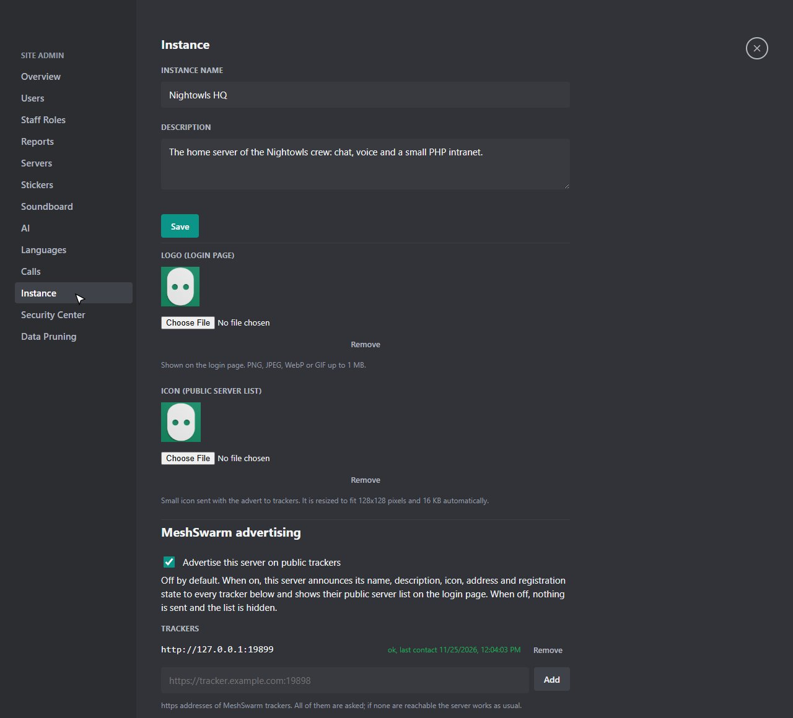
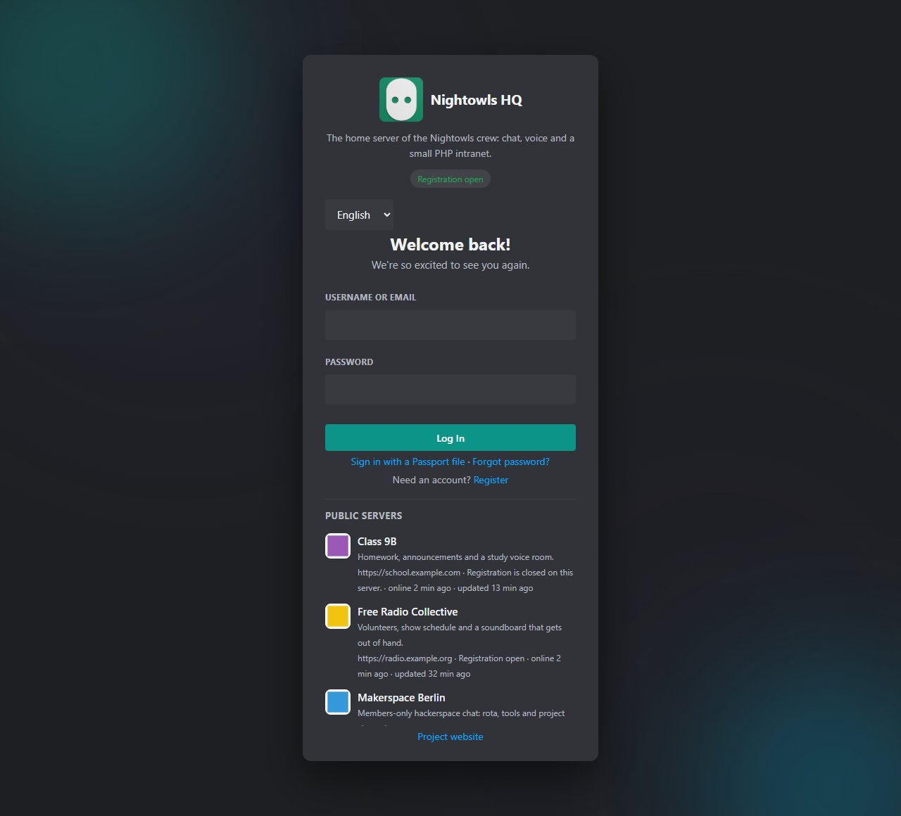

## The admin panel

The admin panel is shown only to accounts with a **site staff rank**. The **Owner** (the first account) has every permission and can create ranks and hand out specific permissions.

| Permission | Allows |
|---|---|
| View Admin Panel | See the panel |
| Manage Users | Disable and enable accounts, edit any profile |
| Manage Site Roles | Create and assign staff ranks |
| Delete Any Message | Remove content anywhere |
| Edit Any Message | Edit any channel or forum message on the instance (never direct messages) |
| Manage Any Server | Delete or transfer any server, create Sites |
| Manage Reports | Work the user report queue |
| Prune Data | Bulk-delete history by date |
| Manage AI | Configure AI providers and bots on any server |
| Site Administrator | Bypasses all site permission checks |

The panel also shows instance statistics and lets you manage users and servers.

### Servers

**Admin, Servers** lists every server with its owner, member count and creation date. Two ways to remove one:

- **Delete now** removes the server, its channels, messages and files at once. You must type the server name to confirm.
- **Schedule deletion** sets a timed deletion in hours or days. The server stays usable until then, the list shows the date, and **Cancel deletion** stops it at any time before it runs.

Both need the **Manage Any Server** permission.

## Instance profile and MeshSwarm

The **Instance** tab of the Admin Panel gives your server an identity: a **name**, a **description**, a **logo** and a small **icon** (PNG up to 1 MB and 4096 pixels; the server shrinks it to 128x128 pixels and 16 KB itself, JPEG, WebP and GIF are converted by the panel first). The login page shows them together with a badge for the registration mode (open, invite only, closed). They are stored under `instance` in `data/config.json` and in `data/instance/`.

**Advertise** (off by default) lets the server announce itself to one or more **MeshSwarm trackers** (default `https://nexnet.hu:19898`, the list is editable). The advert (name, description, icon, address and registration state) is signed with the server's key; the first key to claim an address owns it. When it is on, the login page lists the public servers the trackers return, with last online and last updated times, and clicking one opens it. When it is off nothing is sent and the list is hidden. The panel reports an address trackers would reject (no HTTPS, empty `publicHost`), and an unreachable tracker never affects the server. A tracker you remove, or advertising you switch off, gets a signed delete. Trackers are a separate app (MeshSwarm, with its own README); the server works the same without any.

## Attachments

Under **Admin, Overview** you can lower the upload size limit at runtime (never above `maxUploadMb` in the configuration) and optionally restrict uploads to an allowlist of extensions such as `.png, .jpg, .pdf`. Executables, HTML and SVG are always blocked, and files are served as downloads under a sandboxing Content-Security-Policy so an upload can never run as script in the app's origin.

## Sessions

Session lifetime is a site setting. Members can review and revoke their own sessions under **Settings, Devices** (see [Accounts](accounts.html#your-devices)), and disabling an account ends its sessions and live connections immediately.

## Data pruning

- Server moderators with **Prune Content** prune their own server's channels and threads from **Server Settings**.
- Site administrators with **Prune Data** can prune any server's channels or any DM from the admin panel. Conversations are listed by size, and message content is never shown.
- Group DM creators can prune their own group.

Every prune shows a preview first and can run immediately or after a 24-hour notice. See [Moderation and safety](moderation.html#data-pruning).

## Languages

The interface ships in English and Hungarian. Administrators can add language files from the admin panel. Strings are plain JSON, so a translation is a copy of the English file with the values changed.

## Backups

::: note A backup is a folder
Stop the server and copy the whole `data/` folder: the database, the configuration, the certificate and every uploaded file. To restore, put the folder back.
:::

Schedule it with the tool of your choice. If you cannot stop the server, copy at a quiet moment and keep several generations. Test a restore once.

## The admin console

The console is a text interface for the person who runs the server. It starts in the server window when the server is launched from a terminal (no login is needed there, you already control the machine), and optionally over SSH. Type `help` for the list and `help <command>` for details. Destructive commands ask for confirmation; add `--yes` to skip it.

| Command | Does |
|---|---|
| `account list/info/create/passwd/delete/disable/enable/roles/grant/revoke/roleperm` | Manage accounts and site roles (`roleperm` adds or removes the console permission on a role, server window only) |
| `ban`, `unban`, `kick` | Disable or re-enable an account, or disconnect a user |
| `ipban`, `ipunban` | Ban an IP, range or CIDR, optionally for some minutes |
| `config list/get/set/reset/path` | Read and change `data/config.json` with validation |
| `backup create/list/delete/verify/keep/auto/restore` | Backups (see below) |
| `purge` | Resets the server to a factory state: all accounts, servers, messages, DMs and uploads are deleted, then it restarts. Server window only. Needs `purgePassword` in `data/config.json` (empty means disabled), asks for it and for you to type `PURGE`, and makes a safety backup first. Configuration, certificates and backups are kept |
| `server stop`, `server restart`, `server cancel` | Stop or restart with an optional countdown in seconds |
| `status`, `list`, `stats`, `stats watch` | Version, uptime, online users, load and statistics |
| `announce <text>` | Show a notice to every online user |
| `log tail/show/level/files` | Live log, recent entries, log level, log files |
| `ssh status`, `ssh kick <n>` | SSH fingerprint, address and sessions |

`server restart` needs the supervisor: start the server with `npm start`, `start-server.bat` or `start-server.sh`. These restart it when it exits with code 42. Without them `server restart` only stops the server.

### SSH access

1. Set `ssh.enabled` to `true` (`config set ssh.enabled true`, or edit `data/config.json`) and restart. By default it listens on `127.0.0.1` port `2222`, so only the machine itself can connect.
2. Give the account access: the **Owner** can always use the console; staff need the site permission **Manage Console**. Site Administrator does not include it. If nobody has it yet (for example after an upgrade), run `account roleperm Owner +console` in the server window.
3. In PuTTY enter the host and port, choose connection type SSH and open it. On the first connection PuTTY shows the host key fingerprint. Compare it with `ssh status` in the server window (or the `[ssh] listening` line in the log) before pressing Accept. A different fingerprint later means a different server or an attack.
4. Log in with your MeshCrowd username and password. If the account uses two-factor authentication you are asked for the code after the password. Clients that can only send a password (no keyboard-interactive prompt) cannot sign in to 2FA accounts.

To reach it from other machines set `ssh.listenAddress` (for example `0.0.0.0`) and open the port in your firewall. Prefer a VPN or an SSH tunnel and leave it on localhost if you can; the server logs a warning when it listens on a non-loopback address.

::: warn Security notes
Accounts with strengthened sign-in never send their password to the web server, but SSH has no browser to derive the key. Over SSH the server therefore receives the plaintext password inside the encrypted SSH channel, derives the key in memory, checks it and discards it. It is never stored or logged. Five failed logins from one address lock that address for 10 minutes (one network behind a NAT shares that lock, so an attacker can lock you out for a while; use the server window to recover). Sessions end after `ssh.idleTimeoutMinutes` of inactivity and at most `ssh.maxSessions` run at once.
:::

### Console backups

`backup create` writes `data/backups/backup-<UTC time>-<manual|scheduled|pre-restore>.zip` containing a consistent database snapshot, `config.json` and small media (avatars, banners, emoji, stickers, sounds and icons; files above `backup.maxFileMb` are skipped). Not included: chat attachments, Sites, certificates and the SSH host key. Secrets such as the TURN secret are replaced by a placeholder unless `backup.includeSecrets` is true. `backup verify` checks the archive against its hashes.

The newest `backup.keep` backups are kept (default 7), older ones are deleted after each backup. Copies made right before a restore are kept separately (`backup.preRestoreKeep`). `backup auto 03:30` schedules a daily backup at that server-local time, `backup auto off` stops it.

`backup restore <name>` only works in the server window, never over SSH. It verifies the archive, saves the current database as a pre-restore backup, replaces the database, media and configuration and restarts the server. Live secrets and certificates are kept.

### Logs

Logs go to `data/logs/dismesh-YYYY-MM-DD.log`, one file per day, a new numbered file when one grows past `logging.maxFileMb`, and files older than `logging.keepDays` are deleted. Levels are `debug`, `info`, `warn` and `error`; `log level warn` changes it immediately and saves it. Logins and failed logins (with the IP), account and role changes, bans, console commands and the server lifecycle are logged. Passwords, tokens, keys and message content never are.

## The Launcher

`Launcher.exe` is an optional Windows control panel that sits next to the start scripts. The server never needs it. It creates the data folders and a default `config.json` when missing, and offers:

- A **config editor** for every `config.json` setting, with a description, range, default and a restart-needed hint, a diff before saving and automatic config backups. Settings that need a restart say so.
- **Start, stop and restart** of the server with supervision, a live **console**, **logs** and crash reports.
- The same console commands as the [admin console](#the-admin-console), and a doctor check for common problems.

## Updating

Take a backup, stop the server, replace the program files (keeping `data/`) and start again. Database changes are applied automatically. See [Installation](installation.html).

## Monitoring

The server logs to standard output: certificate fingerprints, migrations, warnings and errors. Watch that log with your service manager. A simple health check is requesting the login page.

## Moving to a new machine

Copy `data/` to the new machine and start the server there. If the address changes, update `publicHost` and delete `data/certs/` to get a new certificate. Clients that trusted the old certificate will ask again.
