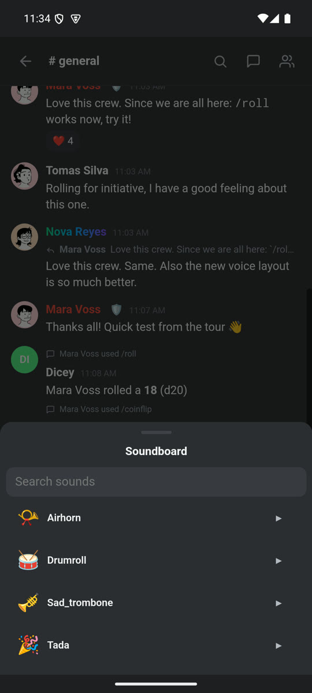
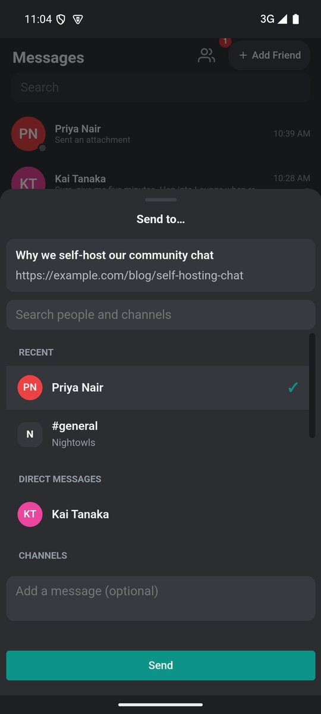
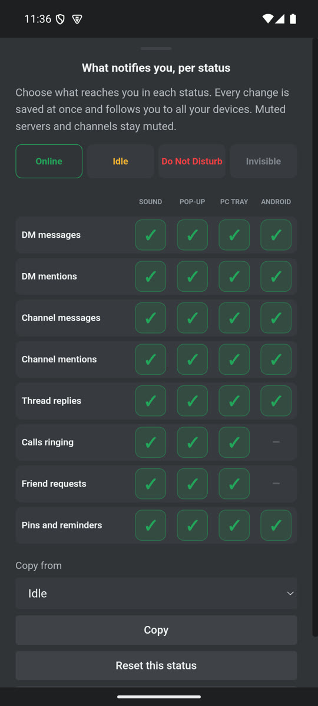
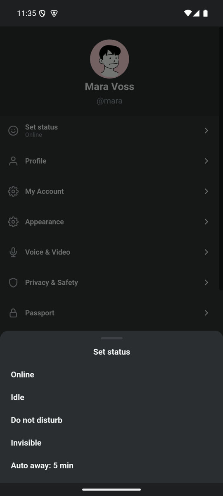
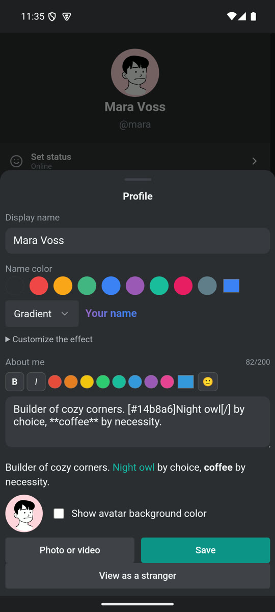

The Android app is a thin Kotlin shell (Android 8.0 or newer, one universal APK, no native libraries) around the phone interface your server serves at `/m/`. Because the whole interface comes from your server, **updating the server updates every phone** and a new APK is only needed when the shell itself changes.

## Installing

1. Download the APK on your phone and open it. Android asks you once to allow installs from your browser or file manager.
2. Open the app and type your server address: `chat.example.com`, `192.168.1.44:8080`, or with `http://` or `https://`. HTTPS is tried first.
3. A **self-signed certificate** is trusted once, by its SHA-256 fingerprint. Compare it with the fingerprint your server prints at start before you accept.
4. A plain `http` address is allowed, with a warning. Calls and notifications need HTTPS.

## Using it

- **Keyboard and files**: tapping a field raises the keyboard; attachments use the system file picker; downloads (including decrypted DM files) go to the Downloads folder with a notification.
- **Invite links**: tapping an `mcr://` link (the **Open in app** button on an invite page) opens the app. For the server the app is already set up for it asks to join; for another server it asks first, shows the connect screen with the address filled in, and asks to join once connected. Needs version 3.9 or newer.
- **Back button**: closes sheets and screens first. On another tab it goes back to the Servers tab, and from Servers it exits.
- **Calls**: voice, camera and DM calls work in the phone interface. The app asks for microphone and camera permission for your server only.
- **Changing server**: the **You** tab has an option to disconnect and enter another address.
- **Known servers**: the app remembers the servers you have used (name, icon and trusted certificate) and lists them on the connect screen: tap one to reconnect, long-press to remove it. A login page's public list can switch the app to another server after a native confirmation. Notifications always follow the one server the app is set up for.
- **Staying signed in**: a login is kept until you log off (or the server's session expires), also across restarts. There is no "stay signed in" question.
- **Start view**: under **You**, **Open on start**, choose the tab the app opens on (Servers, Messages, Notifications or You) or the last chat you had open.
- **Message style**: choose plain chat or chat bubbles under **You**.
- **Administration asks for your password**: opening the Admin Panel or Server Settings asks you to confirm your password first, so a phone left unlocked does not hand over the administration screens.



## Sharing to MeshCrowd

From 3.26 the app is a target in Android's **Share** menu. Share a link from your browser, a picture from the gallery or any file from a file manager, choose **MeshCrowd**, and a **Send to...** sheet opens:

- a preview of what you are sharing (the link or text, picture thumbnails, file names and sizes);
- a search box and the list of your **direct messages** and the **text channels you may write in** on the server you are logged in to, recent destinations first, each with its avatar or server icon;
- an optional note that is sent with it.

Tap a destination and **Send**. Nothing is sent before that, **Cancel** (or tapping outside the sheet) sends nothing, and after sending you are back in the app you shared from. Files use the normal upload, so the server's size limit applies and is explained when a file is too large. Several files can be shared at once. Your four most recent destinations also appear as **Direct Share** targets in the system share sheet (Android 10 and newer).

Only files that the sharing app hands over are read, and only for the share you are looking at.



## What works on the phone

The phone interface covers the same features as the desktop one:

- **Messaging**: channels, threads (custom channel and thread icons show in the lists and the chat header), forum channels (cards with search, sorting and previews that open as threads), direct and group chats with encryption, reactions, replies, polls, voice messages, stickers, slash commands, scheduled messages and saved messages. The emoji button opens the full picker with categories, search, recents, custom emoji and `:shortcode:` suggestions, and the sticker picker has search. A red **New** line marks the first unread message when you open a chat; see [Unread messages](personalization.html#unread-messages).
- **Notes channels** (your encrypted journal) and **Sites** open full screen.
- **Voice**: voice rooms and stages, camera, soundboard and a live list of who is in each room right under the channel. Server channels and threads also have a music-note button in the message box: tap a sound to send it as a sound message with a play button (or to play it into the call when you are in voice on that server); the ▶ next to a sound previews it only for you.
- **Server management**: the server menu has Events, Server Settings (roles, channels, members, invites, AutoMod, bots, onboarding, audit log and the rest), Create Channel and Create Category, shown only to people with the permission.
- **Your account**: the **You** tab opens account, appearance (themes), voice and video, privacy, Passport and security settings, saved and scheduled messages, and the **Admin Panel** for site administrators, including federation.
- **Federated servers** from paired instances appear in the server list with a globe badge; long-press one to leave it.

Settings and admin screens use the same pages as the desktop app, laid out as a scrolling tab strip with the content below.







## Notifications without Google services

The app polls your server itself, so it needs no Firebase or Google Play Services. There are three modes, all selectable under **You, Android app**:

| Mode | How it works | Battery |
|---|---|---|
| Periodic check | WorkManager every 15 minutes or longer | Very light |
| Fast mode (on by default) | A foreground service with a permanent notification, polling every 1 to 1440 minutes | Heavier |
| UnifiedPush | The server wakes the phone through a distributor app such as ntfy | Light and instant |

The permanent notification of fast mode comes back by itself if you swipe it away (Android 14 and newer allow dismissing it). Encrypted DMs show only a generic "New encrypted message". Tapping a notification opens that conversation. Notification and app texts follow the phone's language (English and Hungarian). The **Notifications** tab has a trash button that clears the whole list, and the tab only lists messages from conversations you are not looking at.

### While you use the app

From 3.28, with an up-to-date server:

- The **MeshCrowd is connected** notification stays up while the app is open as well as in the background. It reads **MeshCrowd is offline** when the phone has no internet connection. With fast mode on you also see its own permanent notification.
- Messages arrive instantly over the WebSocket. Only the conversation you are looking at stays silent: other channels, threads and direct messages raise a system notification as they do in the background.
- Your settings still decide what notifies you: muted conversations, **mentions only** and [the notification grid](messaging.html#the-notification-grid).
- Opening a conversation removes its notifications.

With an older server, nothing is announced while the app is open.

### UnifiedPush

1. Install a UnifiedPush distributor, for example **ntfy** (self-hosted or public).
2. In the app open **You, Android app, Push notifications** and turn it on, choosing your distributor.
3. The server then sends a fixed wake-up (`{"t":"wake"}`) to the address the distributor gave the app. The message text never passes through the distributor: the app wakes up and fetches notifications itself.

::: note A ntfy on your own network
Addresses on private networks are refused by default because users supply them. If your ntfy runs on your LAN, set `pushAllowPrivateEndpoints` to `true` in `data/config.json`.
:::

The periodic check keeps running as a safety net, so set it to a long interval when you use UnifiedPush.

## Building the APK yourself

You need JDK 17 and the Android SDK (platform 35 and build-tools 35). Set `sdk.dir` in `android/local.properties`, then:

```
cd android
./gradlew collectApk
```

`collectApk` builds the release APK and copies it to `AndroidReleases/MeshCrowd-<version>.apk`. Release builds are signed with a key you create (`meshcrowd.jks`, configured in `keystore.properties`; both stay out of version control). **Keep a backup of that key**: an update must be signed with the same one. `./gradlew testDebugUnitTest` runs the unit tests.

## Known limits

- Older apps (before 3.0) cannot sign in to an account that uses strengthened sign-in. Update the app.
- Screen sharing is not available on phones.
