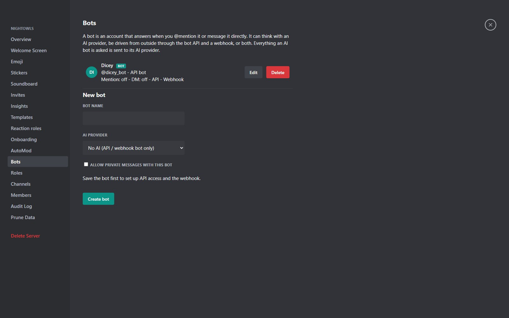

A **bot** is a special account that belongs to one server. Its name carries a **BOT** badge and it cannot sign in. One bot can do two jobs at the same time:

- **An AI chat partner** backed by Ollama or any OpenAI-compatible service. It answers mentions and, if you allow it, private DMs.
- **An integration** driven by the **Bot API** and **signed webhooks**, for n8n, scripts and your own tools.



## Creating a bot

Server administrators with **Manage Bots** create bots under **Server Settings, Bots**. Site administrators can also create them for any server in the admin panel. A bot has a name, an avatar, an optional AI provider and model, a persona (the system prompt), mention on or off, DM mode on or off and the number of recent messages it sees. **Leave the provider empty for an API-only bot.**

## AI bots

Providers are set up by a site administrator under **Admin, AI**: a kind (Ollama or OpenAI-compatible), a base URL, an optional API key (stored encrypted and never shown again), an optional model allowlist (press **Test connection** to fetch the list), a timeout and a parallel-request limit. Tick **Server admins may use this provider** to offer it to server admins.

::: warn Privacy
Everything a bot is asked is sent to its provider. Bots never read end-to-end encrypted DMs, group DMs or Notes channels, and only see channels their role can view. Their output cannot mention anyone and has no tools or actions.
:::

On a CPU-only host use small models (about 3 to 4 billion parameters), or point the provider at an Ollama running on a stronger machine. Limits: one request per provider at a time by default, at most five waiting, a ten second cooldown per user and bot, and replies capped at 4000 characters.

## The bot token

Open a bot and press **Generate token**. The token (it starts with `mcb_`) is shown **once**; only its SHA-256 hash is stored. Regenerating it stops the old one working. Send it as a header:

```
Authorization: Bot mcb_xxxxxxxxxxxxxxxxxxxxxxxx
```

A bot sees only its own server, only what its roles allow, never Notes channels and never encrypted or group DMs. Limits are 120 requests and 30 writes per minute per bot (`429` with `Retry-After`). `@everyone` and `@here` in bot messages are defused.

## Bot API

| Request | Purpose |
|---|---|
| `GET /api/bot/me` | Who the bot is and its webhook state |
| `GET /api/bot/channels` | Channels the bot can view |
| `GET /api/bot/messages?scopeType=channel&scopeId=7&limit=50` | Read an oldest-first page of messages |
| `POST /api/bot/messages` | Post a message |
| `PATCH /api/bot/messages/:id` | Edit one of the bot's own messages |
| `DELETE /api/bot/messages/:id` | Delete one of the bot's own messages |
| `PUT /api/bot/commands` | Publish slash commands: see [Slash commands](slash-commands.html) |
| `POST /api/bot/interactions/:id/respond` | Answer a slash command |

Posting a message:

```
curl -X POST https://chat.example.com/api/bot/messages \
  -H "Authorization: Bot $TOKEN" -H "Content-Type: application/json" \
  -d '{"scopeType":"channel","scopeId":7,"content":"Build 214 passed"}'
```

`scopeType` is `channel`, `thread` or `dm` (a DM needs the bot's DM mode on). Content is up to 4000 characters. The complete reference is in `docs/API.md` in the repository.

## Outgoing webhooks

Give a bot a **webhook URL** and MeshCrowd sends it a signed JSON event whenever something it should hear about happens. In the bot's settings choose which messages count: **mentions** (an @mention, a reply to the bot, or a DM) or **all** messages in channels it can see.

Create the **signing secret** with **Rotate secret**; it is shown once. Every delivery is a `POST` with these headers:

| Header | Meaning |
|---|---|
| `X-MeshCrowd-Event` | `message_create`, `command` or `ping` |
| `X-MeshCrowd-Delivery` | A unique id for this delivery |
| `X-MeshCrowd-Timestamp` | Unix seconds |
| `X-MeshCrowd-Signature` | `sha256=` followed by the HMAC-SHA256 of `<timestamp>.<raw body>` keyed with the secret |

Verify the signature and reject deliveries whose timestamp is more than a few minutes old:

```js
const expected = 'sha256=' + crypto.createHmac('sha256', secret)
  .update(timestamp + '.' + rawBody).digest('hex');
const ok = crypto.timingSafeEqual(Buffer.from(expected), Buffer.from(signatureHeader));
```

A message event looks like this:

```json
{ "type": "message_create", "trigger": "mention",
  "bot": { "id": 4, "userId": 12, "username": "relay_bot" },
  "server": { "id": 2, "name": "Hooks" },
  "channel": { "id": 7, "name": "general", "type": "public" },
  "message": { "id": 91, "content": "@relay_bot summarise this",
    "author": { "id": 3, "username": "anna", "displayName": "Anna", "isBot": false } } }
```

Messages written by bots never trigger a delivery, so bots cannot loop. Events for one bot are delivered in order. A 5xx, 429, 408 or network error is retried (three attempts in total, after about 0, 5 and 30 seconds); other 4xx answers are not retried; at most 50 events wait per bot. The URL may carry a path and query but no credentials, redirects are not followed, and a private address (localhost or LAN) is allowed only if a **site administrator** saved the URL. Use **Send test event** to check your receiver.

## An n8n recipe

1. Add a **Webhook** trigger node (method `POST`) and paste its production URL into the bot.
2. Optionally verify the signature in a Code node.
3. Answer with an **HTTP Request** node: `POST https://your-host/api/bot/messages`, header `Authorization: Bot <token>`, JSON body `{"scopeType": "channel", "scopeId": {{ $json.body.channel.id }}, "content": "...", "replyToMessageId": {{ $json.body.message.id }}}`.

For a thread use `scopeType: "thread"` with the event's `threadId`, and for a DM `scopeType: "dm"` with its `dmId`.

## Incoming webhooks

A simpler tool for scripts that only post: a channel manager creates an **incoming webhook** in the channel's settings and gets a URL. `POST` JSON to it and a message appears under the webhook's name and avatar. No bot or token is needed.

## Good practice

- Keep tokens and secrets out of repositories; rotate them if they leak.
- Give a bot a role with only the channels it needs.
- Handle `429` by waiting for `Retry-After`.
