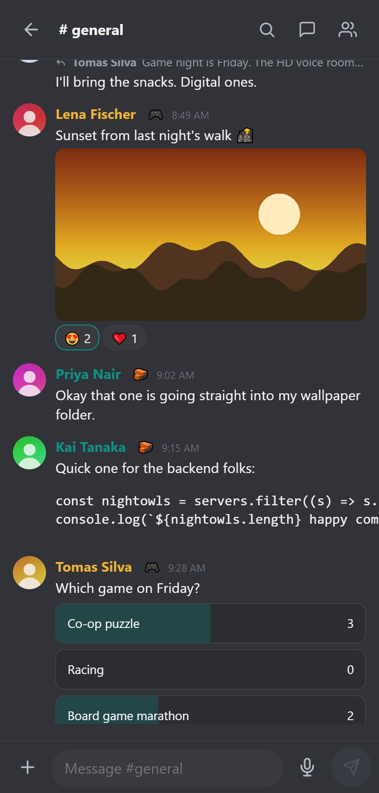

All clients talk to the same server and show the same data. Pick whichever suits the moment.

| Client | Best for | Notes |
|---|---|---|
| Web | Everything, nothing to install | Every feature, in any modern browser |
| Desktop (Windows) | Daily use at a desk | Tray badge, native notifications, certificate pinning |
| Android | On the go | Phone interface, local notifications, optional UnifiedPush |

## Web

Open the server address. Sign in and you have every feature. Add it to your home screen from the browser menu if you like. Phone browsers are served the phone interface automatically; add `?ui=desktop` or `?ui=mobile` to the address to switch.

## Desktop app (Windows)

A portable app: unzip it and run `MeshCrowd.exe`. On the first launch it asks for a server address such as `https://192.168.1.10:8443`, then loads the same interface as the browser and adds:

- A **tray icon** with a live unread badge colored by your presence. Colors are customizable under **Settings, Desktop App, Tray Icon**.
- A **connecting screen** with a spinner while the server answers. If it cannot be reached (or takes over 20 seconds) it offers **Retry** and **Change server** instead of a blank window.
- **Native notifications**, close to tray and start with Windows.
- The operating system's **screen and window picker** for screen sharing.
- **Invite links**: `mcr://` links from an invite page open in the app. The app registers itself for them on every start, which also repairs the entry after you move the folder; switch it off under **Settings, Desktop App**. Links always ask before switching server and before joining. `register-mcr-protocol.bat` and `unregister-mcr-protocol.bat` next to `MeshCrowd.exe` do the same by hand.
- **Trust-on-first-use certificate pinning** for self-signed servers: the first time you confirm the fingerprint, and a later change raises a warning. A certificate from a public authority is accepted normally.

The app stores its settings in a `data` folder next to the executable, so the whole folder can live on a USB stick. It carries no server and no web files of its own: updating the server updates the interface.

To run it from source for development: `npm install` then `npm run electron`.

## Phone interface

The server serves a phone-first interface at `/m/`, used by Android browsers and by the Android app. It has four tabs (Servers, Messages, Notifications, You), long-press menus, bottom sheets, voice messages, polls, scheduling by holding the send button, slash command chips and calls. See the [Android app](android.html) guide for installation and notifications.

## Language and themes

Language and theme are saved per account, so they follow you from client to client.
