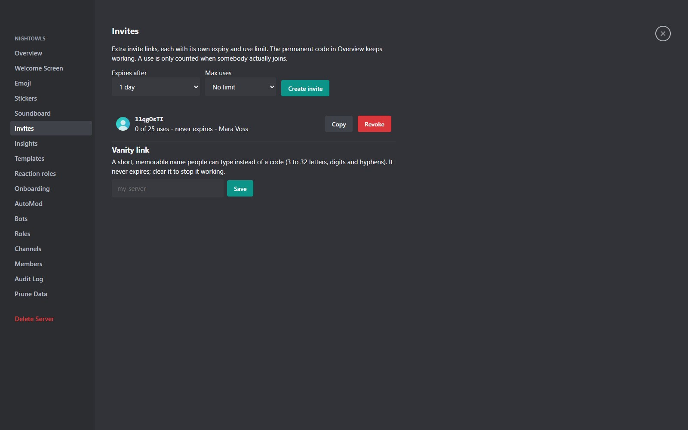
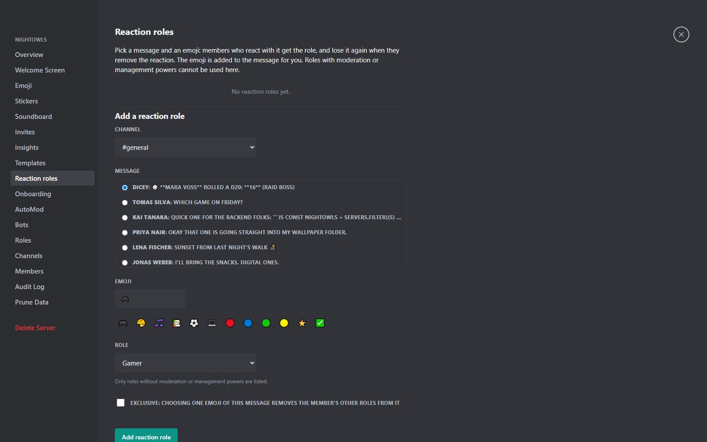
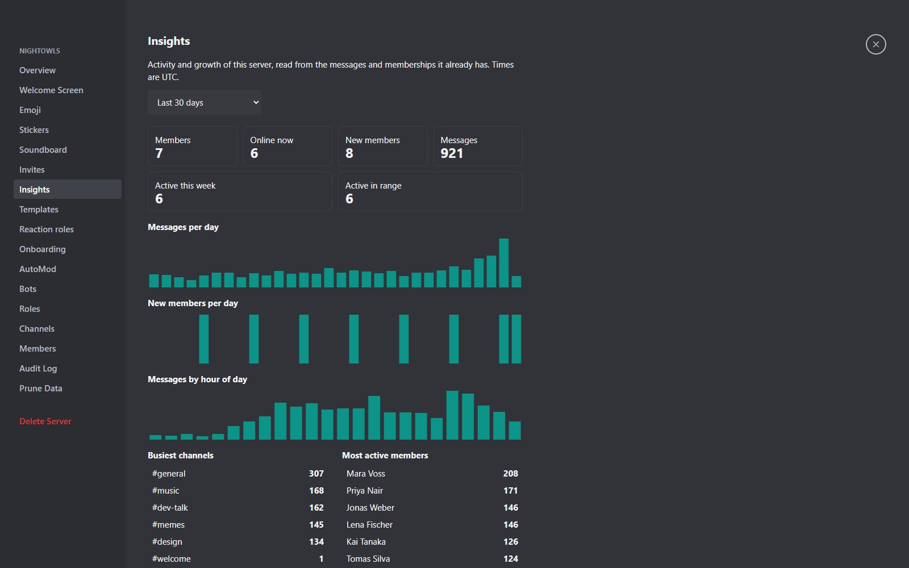

## Invites and vanity links

**Server Settings, Invites** creates extra invite links, each with its own expiry and use limit. The permanent invite code in **Overview** keeps working.

- **Expiry**: from one minute to 90 days, or never.
- **Maximum uses**: 1 to 1000, or unlimited. A use only counts when someone actually joins.
- **Limits**: at most 25 active invites per member and 100 per server.
- **Vanity link**: a short name (3 to 32 letters, digits and hyphens) people can type instead of a code. It never expires; clear it to stop it working.
- **Direct invites** can be sent from a person's profile card, and channel invites give access to just one channel.

An expired or used-up invite tells the person so instead of failing silently.

## Server templates

**Server Settings, Templates** saves the structure of the server as a template with a share code: roles with their permissions, categories, channels, channel permissions and the rules text. Anyone who pastes the code in the **Template code** field when creating a server gets a brand-new private server with that structure and becomes its owner.

Members, messages, emoji, bots and invites are **never** copied. After you change your server, **Update** refreshes the template.

## Reaction roles

**Server Settings, Reaction roles** (needs **Manage Roles**). Choose a channel and one of its recent messages, an emoji and a role. Members who react with that emoji get the role and lose it when they remove the reaction. The emoji is placed on the message for you.

- Tick **Exclusive** so that the emojis of one message behave like a single choice.
- Roles with moderation or management powers cannot be used.
- Members who still have to accept the server rules cannot react.

## Onboarding

See [Moderation and safety](moderation.html#rules-screening-onboarding): rules, questions that hand out roles and acceptance before posting.

## Scheduled events

Create a server event with a name, description, location, optional linked channel and start and end times. Members can mark themselves **interested**, and changes are broadcast live.

## Insights

**Server Settings, Insights** (needs **Manage Server**) shows member count and growth, messages per day and per hour of day, the busiest channels, the most active members and how many people were active this week, for the last 7, 14, 30 or 90 days.

Everything is computed from the messages and memberships that already exist. Nothing extra is tracked. Times are UTC and the numbers refresh about once a minute.

## Welcome screen

Highlight a few channels with a short description each, so a new member knows where to start. Open **Server Settings, Welcome Screen**.

## Custom emoji, stickers and soundboard

Upload your own emoji and stickers (images) and a **soundboard** of short clips under **Server Settings**. Emoji work in messages and reactions; stickers are sent as a message; the soundboard plays into voice rooms. Animated stickers (GIF, APNG, animated WebP) stay still in the picker and the sticker editors until you hover them, and in chat only the six newest on screen play at once; hover any sticker to play it.
