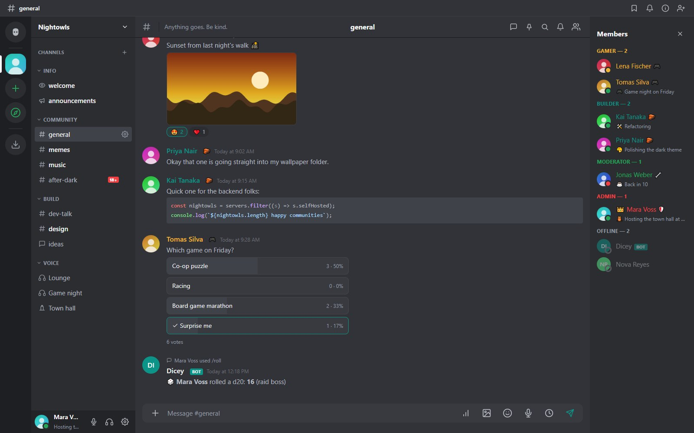
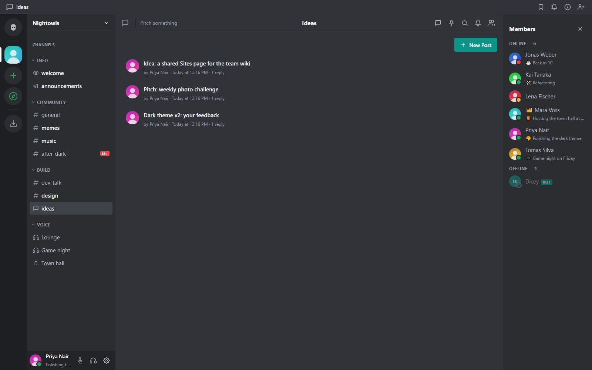
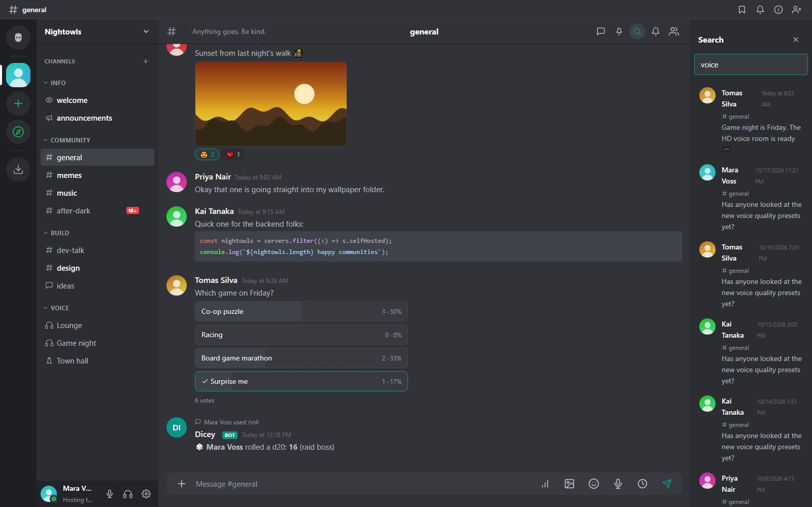

## The basics

Type in the box at the bottom and press **Enter**. Use **Shift+Enter** for a new line. Hover a message for its actions: reply, react, thread, edit, pin, forward and more. Press **Up** in an empty box to edit your last message.

### Formatting

- `**bold**`, `*italic*`, `` `code` `` and fenced code blocks with a language for highlighting.
- `||spoiler||` hides text until clicked.
- Type `:` and a name for emoji shortcodes, `@` for mentions and `#` for channels.
- Links get a preview card unless you are in an encrypted DM.

### Mentions

`@username` notifies a person, `@rolename` a role (single-word names), and `@everyone` or `@here` everyone or the people online. Bots can never ping the whole server.

## Replies, threads and forums

- **Reply** to quote a message. **Forward** copies a message to another conversation.
- **Threads** start from any message and have their own history. The **Threads** panel lists every thread in a channel. A thread's creator or a channel manager can give it an icon or delete it.
- **Forum** channels consist entirely of posts, each with its own thread. Posts show as cards with the author, a preview of the opening message, an image thumbnail, the reaction count and the reply count. A search box finds or starts a post, you can sort by **Recent activity** or **Newest posts**, and closed posts carry a **Closed** badge and accept messages from moderators only. On a wide screen the chosen post opens beside the list; on a phone it opens full screen.

## Reactions, polls and pins

Click a reaction to add yours. **Polls** take a question and options and show live percentages; you can choose several options when the poll allows it. Pinned messages are listed in the pin panel.

## Attachments

Up to five attachments per message. Still images can be resized before upload (Original, 1920, 1280 or 800 pixels), animated GIFs get a play and pause button, and non-ASCII file names are kept. The size limit comes from `maxUploadMb` and the admin panel; some file types (executables, HTML, SVG) are always refused.

## Voice messages

The **microphone** button in the composer records up to five minutes. A red bar shows the time; the bin discards the clip and the send button posts it with a small player (play, progress, seek). It is recorded as Opus in the browser, desktop app or Android app and needs microphone permission and HTTPS or `localhost`. Voice messages are not available in end-to-end encrypted DMs.

## Scheduled messages

The **clock** button next to the composer opens **Send later** for what you typed. Pick a time or a preset such as tomorrow at 9:00. The message is posted as you at that moment with the same checks as a normal message, so it can still be refused, for example if you are timed out or AutoMod objects. Failures stay in your list with the reason, and you can cancel anything you scheduled. On the phone interface hold the send button.

Encrypted DMs, Notes channels and DMs with people on other servers cannot be scheduled.

## Slash commands

Type `/` to see the commands you can use. Built-in commands include `/me`, `/nick`, `/shrug`, `/spoiler`, `/thread`, `/topic` and `/help`. Bots can add their own; see [Slash commands](slash-commands.html).

## Search

Open search from the magnifier. Tick which fields to match: **message text** (full-text search), **usernames**, **channel names** and **attachment file names**. Results open at the message in its channel. Search covers only conversations you can see; Notes channels and encrypted DMs are not searchable, and age-restricted channels are left out until you confirm your age.

## Notifications

Each channel and DM can be muted, set to mentions only, or to everything (the default is mentions for channels and everything for DMs). Desktop notifications use the browser or the desktop app. The tray icon of the desktop app shows an unread badge. On Android see the [Android app](android.html). A chat you open with unread messages shows a red **New** line above the first one; see [Profiles, status and themes](personalization.html#unread-messages) for its settings.

## Incoming webhooks

A channel manager can create **incoming webhooks** under the channel's settings. A script `POST`s JSON to the webhook URL and a message appears with the webhook's name and avatar. See [Bots, API and webhooks](bots-api.html).
