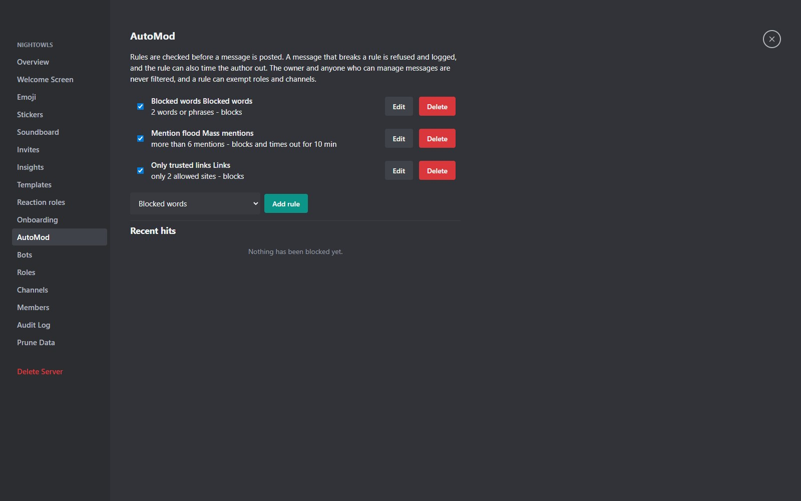
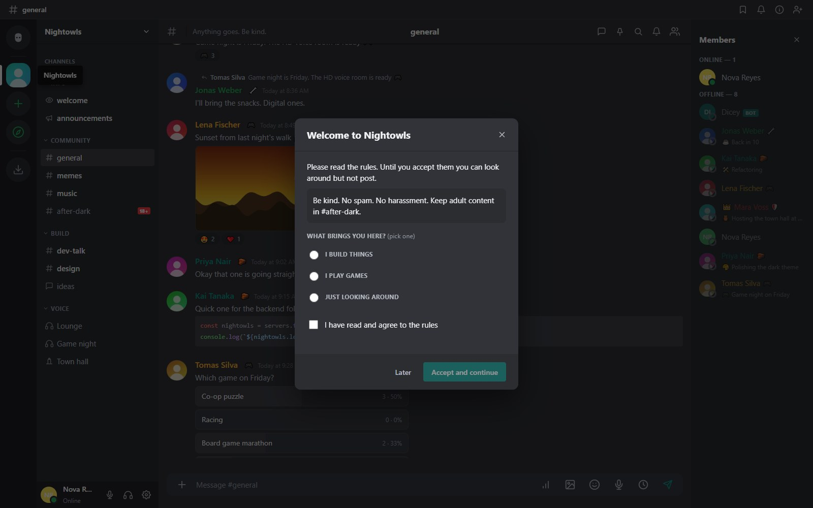
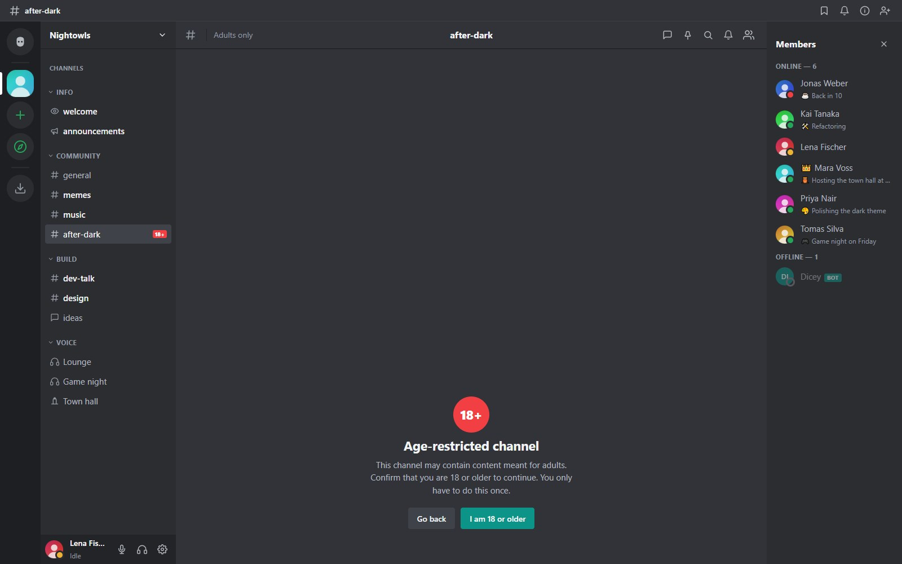

MeshCrowd gives moderators tools that act before a problem spreads and keep a record afterwards. Most are under **Server Settings**.

## AutoMod

**Server Settings, AutoMod** (needs **Manage Server**). Rules are checked before a message is posted in a channel or thread, and again when a message is edited.

| Rule | What it catches |
|---|---|
| Blocked words | Words or phrases, whole-word or substring, with `*` wildcards |
| Links | Block all links, allow only listed sites, or block listed sites (subdomains included) |
| Mass mentions | Too many people or roles in one message; `@everyone` and `@here` always count as too many |
| Spam | Too many messages in a window, or the same message repeated |
| Capitals | Too large a share of capital letters |

A hit refuses the message, names the rule to the author, logs it (author, channel and the first 200 characters) and, if the rule says so, **times the author out**. Each rule can exempt roles and channels. The owner and anyone who can manage messages in the channel are never filtered. Bots and webhooks are not filtered. The log keeps the latest 500 hits per server.

::: note No regular expressions
Rules deliberately do not accept user-written regular expressions, which could be crafted to hang the server. Use wildcards instead.
:::

## Rules screening (onboarding)

Turn on **Require new members to accept the rules** under **Server Settings, Onboarding**. New members see a welcome window with the rules, up to five questions whose answers hand out roles, and an "I agree" box. Until they accept they can read what their roles show but cannot post, react, attach files or join voice, and choosing **Later** keeps them in that view-only state. Members who are already in are not affected. Roles with moderation or management powers can never be handed out by a question.

## Verification level

**Server Settings, Overview, Verification level** holds back brand-new accounts and recent joiners from posting:

| Level | Requires |
|---|---|
| None | Nothing |
| Low | An account at least 5 minutes old |
| Medium | Account 5 minutes old and a member for 10 minutes |
| High | Account 7 days old and a member for 10 minutes |

The owner, bots and anyone who holds a role other than @everyone are never held back. Everything is local: there is no email or phone check.

## Age-restricted channels

Tick **Age-restricted channel (18+)** when creating or editing a text channel. The channel gets an **18+** badge, and the first time a member opens one they confirm **I am 18 or older** once for their whole account. It is a plain click-through: nothing is verified and nothing is sent to anyone. Unconfirmed members cannot read or post there, and the channel is left out of their search.

::: warn A courtesy gate, not access control
The gate does not stop an unconfirmed member's client from receiving live events for the channel. To keep people out of a channel, use channel permissions and private channels.
:::

## Members: timeouts, kicks and bans

From a member's right-click menu or **Server Settings, Members**:

- **Timeout** stops someone posting or speaking for a while (needs **Moderate Members**).
- **Kick** removes someone, who can rejoin with an invite.
- **Ban** removes someone and blocks them from rejoining.
- **Slowmode** limits how often people can post in a channel.
- **Mute for everyone** in voice rooms.

## Reports

Any member can report a message or a person. Reports go to a queue that site administrators with the reports permission can resolve from the admin panel.

## Audit log

**Server Settings, Audit Log** lists what moderators did: role and channel changes, kicks, bans, invites, AutoMod rule edits and more, with who and when.

## Data pruning

Delete message history older than a chosen date. Server moderators with **Prune Content** can do it for their own server; site administrators can do it instance-wide. Every prune shows a preview (message count, attachments and size) first and can run now or after a **24-hour notice** that gives members time to save things. A notice is always posted in the affected conversation, and attachments can be kept or deleted too.

## Good practice

- Start with a clear rules message and onboarding.
- Turn on a verification level on public servers.
- Give moderators a role with only the permissions they need.
- Review the AutoMod log now and then to tune rules.
