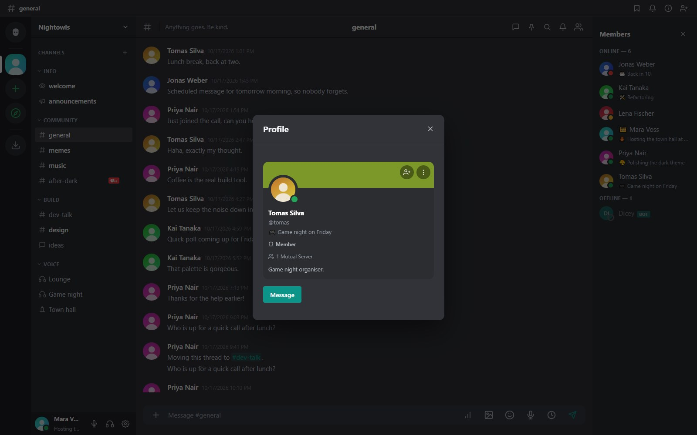
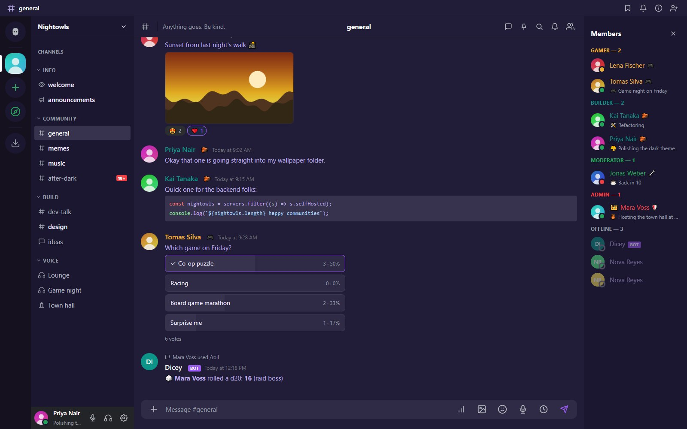

## Your profile

Open **Settings** from the gear in the bottom left. You can set an avatar, a banner image or color, a bio and a display name. A profile card appears when someone clicks your name.

Privacy settings decide who can send you direct messages and who can see your profile card. You can also choose whether you appear in the discovery directory.

## Presence and custom status

Choose **Online**, **Idle**, **Do not disturb** or **Invisible**, and add a custom status with an emoji and text. The slash command `/afk` sets idle with a message. Notification sounds follow your presence by default (online and idle chime, do not disturb stays silent), and you can override that per account.

## Themes

Every member picks their own look under **Settings, Appearance**. Start with a preset and adjust the colors, or build your own:

- **Presets**: MeshCrowd Dark, MeshCrowd Light, Midnight Purple, Forest, Sunset and High Contrast.
- **Colors** for the brand, the rail, the sidebar, the chat background and the text.
- **Fonts**: default, serif, monospace and a few more.
- An optional **background gradient** (start, end and angle) behind the sidebar, chat and member list.
- **Copy CSS** exports your theme as a snippet that someone else can import.

Themes are validated to be plain colors and a font choice. They never carry arbitrary CSS, so a shared theme cannot load external resources.

## Layout

Drag the edges of the channel list and the member list to resize them; the sizes are saved with your account. The server rail can be arranged with folders.

## When you open MeshCrowd

Under **Settings, Appearance** choose what the app shows at start: the Home screen, or **Resume where I left off** (the last server and channel you used).

## Unread messages

When you open a channel or DM that has messages you have not read, a red line with the date and a **New** badge marks the first unread message, and the view jumps there instead of to the bottom. The line stays while the chat is open and is gone the next time you open it. Four settings under **Settings, Appearance** tune it:

- **The "new messages" line**: show or hide it.
- **When opening a chat with unread messages**: jump to the first unread message, or stay at the latest one.
- **Messages shown above the line** (0 to 50): how much context stays visible above the first unread message when you jump.
- **Messages loaded when opening a chat** (20 to 100): how many of the latest messages are fetched. If more messages than that are unread, the line sits at the top of the loaded page and you scroll up for the rest.

The settings are saved with your account, so they apply in the browser, the desktop app and the phone interface alike.

## Language

The interface speaks English and Hungarian. Change it in your settings, or from the selector on the sign-in page. Administrators can add more languages from the admin panel.

## Names and nicknames

A server can give you a **nickname** that only shows there. Server admins can set a per-member name color that beats the role color.
