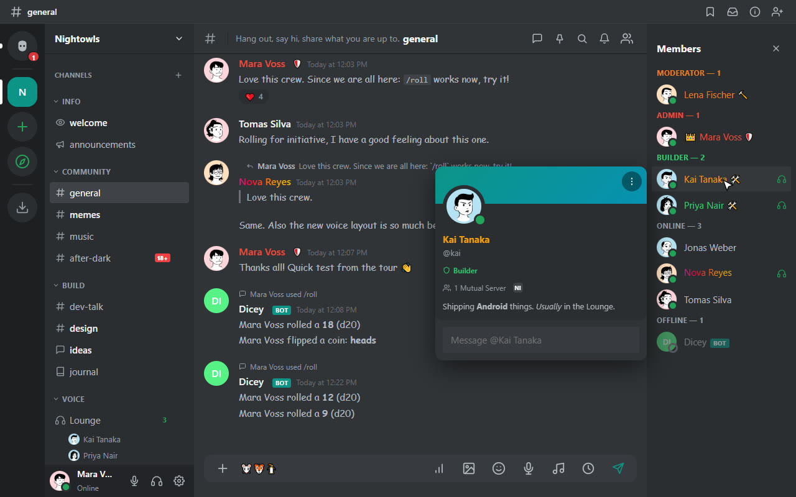
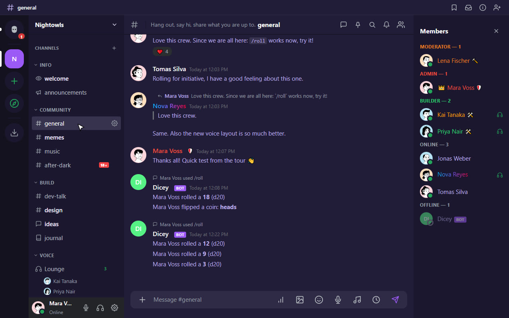

## Your profile

Open **Settings** from the gear in the bottom left. You can set an avatar, a banner image or color, a bio and a display name. The bio editor has bold, italic, color and **emoji** buttons. A profile card pops up next to a name or member when someone clicks it. Clicking your own name shows your own card with an **Edit Profile** button. On someone else's card there is a **Message** button, and a quick-message field when they can be messaged (a friend, or their privacy settings allow it): type, press Enter, and the message is sent in your existing conversation with them, or a new one if you have none yet.

Privacy settings decide who can send you direct messages and who can see your profile card. You can also choose whether you appear in the discovery directory.

## Presence and custom status

Choose **Online**, **Idle**, **Do not disturb** or **Invisible**, and add a custom status with an emoji and text. Open the status menu from your avatar: **Custom Status** edits it and **Remove Custom Status** (shown while one is set) clears it in one click. The slash command `/afk` sets idle with a message. **Auto away**: under **Settings, Status** (on a phone: **You, Set status, Auto away**) set a number of seconds (minutes on a phone) of inactivity after which your status switches to Idle by itself; activity switches it back to Online. 0 turns it off. Only the automatic switch is undone; a status you chose yourself is never changed. What reaches you in each status is set in the notification grid, see [Notifications](messaging.html#notifications).

## Themes

Every member picks their own look under **Settings, Appearance**. Start with a preset and adjust the colors, or build your own:

- **Presets**: MeshCrowd Dark, MeshCrowd Light, Midnight Purple, Forest, Sunset and High Contrast.
- **Colors** for the brand, the rail, the sidebar, the chat background and the text.
- **Fonts**: default, serif, monospace and a few more.
- **Chat font and text size** (accessibility): a separate font (system fonts such as Arial, Tahoma, Calibri, Times New Roman) and a size from 12 to 28 px that change only the message text and the message box, never the rest of the interface.
- An optional **background gradient** (start, end and angle) behind the sidebar, chat and member list.
- **Copy CSS** exports your theme as a snippet that someone else can import.

Themes are validated to be plain colors and a font choice. They never carry arbitrary CSS, so a shared theme cannot load external resources.

## Layout

Drag the edges of the channel list and the member list to resize them; the sizes are saved with your account. The server rail can be arranged with folders.

## When you open MeshCrowd

Under **Settings, Appearance** choose what the app shows at start: the Home screen, or **Resume where I left off** (the last server and channel you used).

## Unread messages

When you open a channel or DM that has messages you have not read, a red line with the date and a **New** badge marks the first unread message, and the view jumps there instead of to the bottom. The line stays while the chat is open and is gone the next time you open it. Four settings under **Settings, Appearance** tune it:

- **The "new messages" line**: show or hide it.
- **When opening a chat with unread messages**: jump to the first unread message, or stay at the latest one.
- **Messages shown above the line** (0 to 50): how much context stays visible above the first unread message when you jump.
- **Messages loaded when opening a chat** (20 to 100): how many of the latest messages are fetched. If more messages than that are unread, the line sits at the top of the loaded page and you scroll up for the rest.

The settings are saved with your account, so they apply in the browser, the desktop app and the phone interface alike.

A banner at the top of the chat reads **N new messages since HH:MM** and offers **Jump** to the first unread message, **Mark as read**, or dismiss. It is there on the web client and the Android app.

## Language

The interface speaks English and Hungarian. Change it in your settings, or from the selector on the sign-in page. Administrators can add more languages from the admin panel.

## Names and nicknames

A server can give you a **nickname** that only shows there. Server admins can set a per-member name color that beats the role color.

### Your own name color and effect

In **Settings, My Account** (or **You, Profile** on the phone) pick a **name color** from the presets or with the free color picker, and optionally a **text effect**: rainbow, gradient, glow, neon, pulse, shimmer, fire or wave. A live preview shows the result. Under **Customize the effect** you can choose your own color stops (up to five: two colors give a two-color blend instead of the full rainbow) and the speed in seconds per cycle. People who prefer reduced motion see the colors without the animation.

Where it shows: your **profile card** and your names in **DMs** always use your own look. In a **server**, a colored **role** wins: its color and its effect (see Roles in [Servers and channels](servers-channels.html)) replace yours, and so does a color a moderator gave you. With no colored role, your own color and effect show.

## Syncing between devices

Settings follow your account automatically. Theme, layout, language, notification levels, DM preferences, folders, nicknames, friends and private channels change on all your signed-in devices within a moment, in place, without a reload. A device that was offline or in the background catches up when it reconnects or comes back to the foreground. **Refresh my other devices** in Settings is only a manual fallback.
