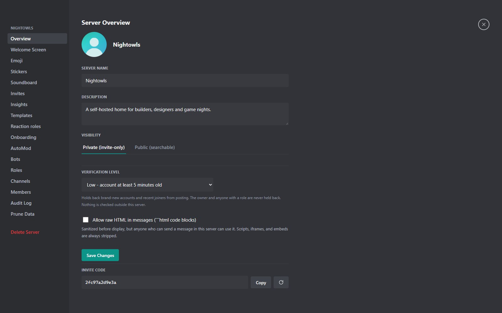
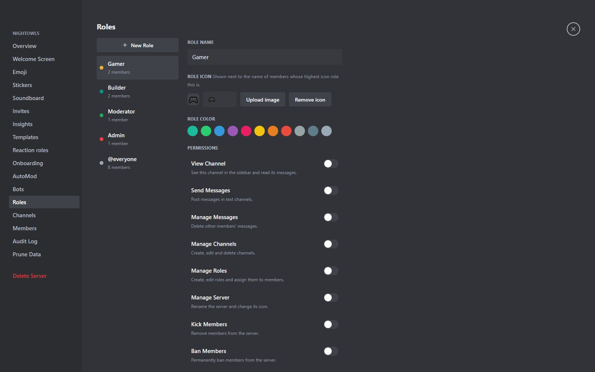

## Servers

A **server** is a community: members, channels, roles and settings. People join by invite code, by a direct invite from someone's profile card, or from the public server directory. A server can be **private** (invite only) or **public** (listed in discovery, optionally auto-join).

Open **Server Settings** from the server name at the top of the channel list.

### Invite links

Every invite code also works as a link: `https://your-server:8443/i/<code>`. It opens a small page with the server's name and icon (and its member count when the server is public), a **Join in browser** button, an **Open in app** button and the download links the server owner has set. Opening the page never uses up an invite, and joining always asks for confirmation first.

- **Copy link** sits next to **Copy** in the invite window and in **Server Settings, Invites** (for every invite and for the vanity link).
- **Join in browser** signs you in or lets you register first, then asks "Join this server?".
- **Open in app** uses an `mcr://your-server:8443/<code>` address. The Windows desktop app and the Android app open it, ask before switching to a different server and ask again before joining. See [Desktop app](clients.html#desktop-app-windows) and [Android app](android.html).
- The old way still works: paste the code into **Add Server, Join with invite**. Channel invites and `code@domain` invites from federated servers work as links too.

## Channel types

| Type | What it is |
|---|---|
| Public text | Anyone with the right to view the server can read and write |
| Private text | Visible only to members a role or override lets in |
| Announcement | A channel people can read but only managers can post in |
| Read-only | Like announcement, for rules and information |
| Voice | A voice room with camera and screen sharing |
| Stage | A voice room split into speakers and audience |
| Forum | A channel made of threaded posts |
| Notes | A private encrypted notebook for each member |

Create channels with the **+** next to **Channels** and organize them into **categories** by dragging. A channel can have an icon, a topic and **slowmode**. A text channel can also be marked **age-restricted**; see [Moderation and safety](moderation.html).

::: note Voice quality is fixed at creation
Voice and stage channels get a quality preset when they are created (Mobile, Low, Medium, High or HD Music). To change it, delete the channel and create a new one.
:::

## Roles and permissions

Roles are sets of permission flags. Everyone has the built-in **@everyone** role, and you can create as many more as you like. A member's permissions are the union of their roles.

| Permission | Allows |
|---|---|
| View Channel, Send Messages, Attach Files | Basic reading, writing and uploading |
| Manage Messages | Delete and pin other people's messages |
| Manage Channels | Create, edit and delete channels, categories and channel webhooks |
| Manage Roles | Create roles and assign them |
| Manage Server | Rename the server, invites, onboarding, AutoMod, templates, insights |
| Kick Members, Ban Members | Remove people |
| Moderate Members | Time people out, set slowmode, mute in voice |
| Create Invite, Change Nickname, Manage Nicknames | Invites and display names |
| View Audit Log | Read the log of moderator actions |
| Prune Content | Delete old history in this server |
| Manage Bots | Create and edit this server's bots |
| Administrator | Everything |

**Nobody can grant a permission they do not hold themselves.** The owner always has every permission, and the server enforces this rule rather than the interface.

### Role colors and icons

Each role has a color, and a **role icon**: an emoji or an uploaded image. The icon of a member's highest role that has one is shown next to their name in chat and in the member list. A per-member **name color** override beats the role color.

### Channel overrides

Open a channel's settings to allow or deny permissions for a role or a single member in just that channel. A deny on a channel beats a grant from a role.

## Notes channels

A **Notes** channel gives every member a private notebook inside the server, with text and up to five attachments per note. Everything is encrypted in the browser with a key derived from your Passport, so the database and the admins cannot read it. Admins can only delete notes older than a date. Notes cannot be searched, forwarded or converted to another channel type, and losing your Passport means losing your notes.

## Server rail and folders

Your server rail is personal: drag servers into **folders** with their own icon and color. Mute a server or a channel, or limit notifications to mentions, from the right-click menu.

## Welcome screen and events

The welcome screen lists highlighted channels for new members. **Scheduled events** have a name, description, location, start and end, and RSVP tracking.

## Next

- Put the rules in front of newcomers with [Community tools](community-tools.html).
- Keep order with [Moderation and safety](moderation.html).
