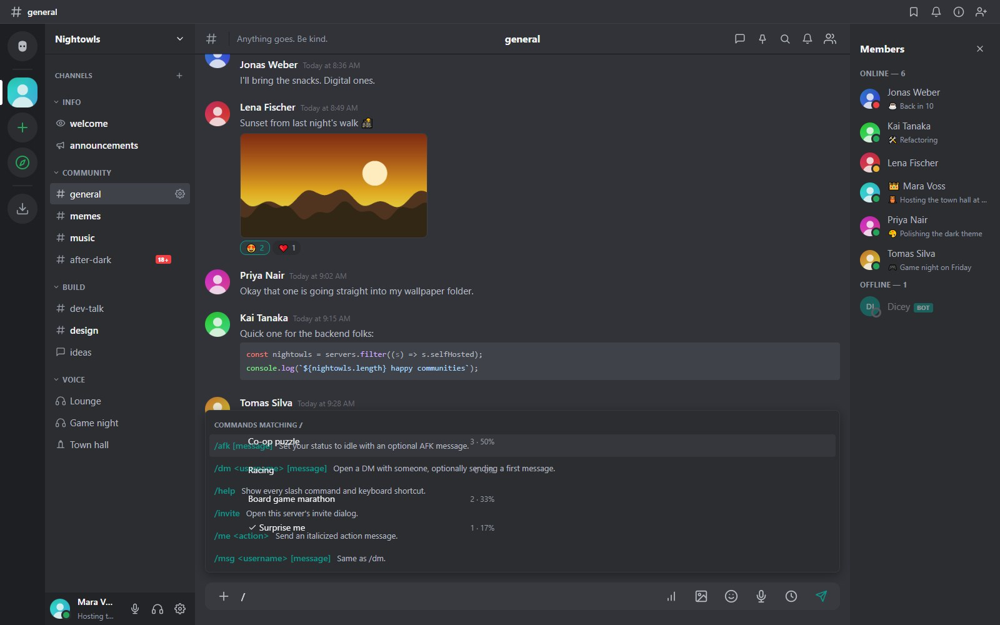
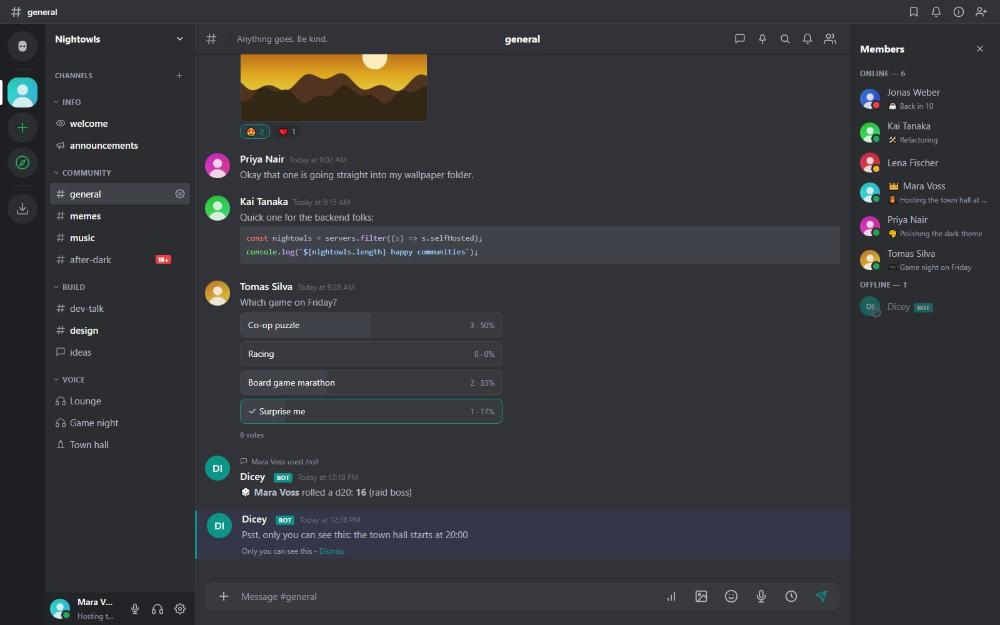

Type `/` in a server channel to see the commands you can use. The list mixes the **built-in commands** with those published by **bots**. On the phone interface, matching commands appear as chips above the composer.



## Built-in commands

| Command | Does |
|---|---|
| `/me <action>` | Posts an action in italics |
| `/nick [name]` | Changes your nickname on this server |
| `/shrug`, `/tableflip`, `/unflip` | Adds the classic text faces |
| `/spoiler <text>` | Posts text hidden behind a spoiler |
| `/thread <name>` | Starts a thread |
| `/topic [text]` | Shows or sets the channel topic (with permission) |
| `/dm`, `/msg <username> [message]` | Opens or writes a direct message |
| `/afk [message]` | Sets you to idle with a message |
| `/invite` | Shows an invite |
| `/ping`, `/help` | Connectivity check and the command list |

## Using a bot's command

Pick a command from the popup (arrow keys and **Tab**, or click it). Options are filled in order, and the **last text option takes the rest of the line**, so no quotes are needed:

```
/roll 20 raid boss
```

You can also name any option: `/roll sides:20 note:raid boss`. If a required option is missing you are told which one and your text is kept. If two bots offer the same command name, the popup shows `name@botname`.

When you press Enter the command goes to the bot, which answers in one of two ways:

- **A normal message**, posted by the bot and headed "Mara used /roll".
- **A private (ephemeral) answer** that only you can see. It is shown in the channel with "Only you can see this", is **never stored**, and disappears when you press **Dismiss** or reload.



## Publishing commands (for bot authors)

A bot needs a **token** and a **working webhook** (see [Bots, API and webhooks](bots-api.html)). Only bots with an enabled webhook show up in the popup, because that is how they hear about a use.

```
PUT /api/bot/commands
Authorization: Bot <token>

{ "commands": [
  { "name": "roll", "description": "Roll a die",
    "options": [
      { "name": "sides", "type": "integer", "required": true },
      { "name": "note", "type": "string" } ] },
  { "name": "whisper", "description": "Only you see the answer",
    "options": [ { "name": "text", "type": "string", "required": true } ] } ] }
```

The call **replaces the whole list**. Rules: at most 25 commands with 10 options each; names use `a-z`, `0-9`, `_` and `-` up to 32 characters; option `type` is `string` (default), `integer` or `boolean`; required options must come first.

### Receiving a use

The webhook gets an event of type `command`:

```json
{ "type": "command",
  "bot": { "id": 3, "userId": 41, "username": "dicey" },
  "server": { "id": 1, "name": "Nightowls" },
  "channel": { "id": 7, "name": "general", "type": "public" },
  "user": { "id": 5, "username": "mara", "displayName": "Mara Voss" },
  "command": "roll",
  "options": { "sides": 20, "note": "raid boss" },
  "interaction": { "id": "9f2c...", "expiresAt": "2026-10-19T12:00:00.000Z" } }
```

Options arrive already converted to their types, and the server has checked that required ones are present.

### Answering

```
POST /api/bot/interactions/<interaction id>/respond
Authorization: Bot <token>

{ "content": "You rolled a 17", "ephemeral": false }
```

Set `"ephemeral": true` for a private answer. An interaction is valid for **15 minutes** and takes at most **five** answers, so a bot can send an acknowledgement and a follow-up.

### A complete example

```js
import http from 'node:http';
const TOKEN = process.env.BOT_TOKEN, BASE = 'https://chat.example.com';

http.createServer((req, res) => {
  let body = '';
  req.on('data', (c) => (body += c));
  req.on('end', async () => {
    res.end('ok');                       // answer the webhook first
    const event = JSON.parse(body);      // verify the signature in real code
    if (event.type !== 'command' || event.command !== 'roll') return;
    const n = 1 + Math.floor(Math.random() * event.options.sides);
    await fetch(`${BASE}/api/bot/interactions/${event.interaction.id}/respond`, {
      method: 'POST',
      headers: { Authorization: `Bot ${TOKEN}`, 'Content-Type': 'application/json' },
      body: JSON.stringify({ content: `${event.user.displayName} rolled a ${n}` }),
    });
  });
}).listen(3000);
```

## Limits

- Commands work in server channels, not in threads or DMs.
- A member needs permission to send messages in the channel, and must not be timed out or held back by a verification level.
- Using commands is limited to 10 per 10 seconds per person.
