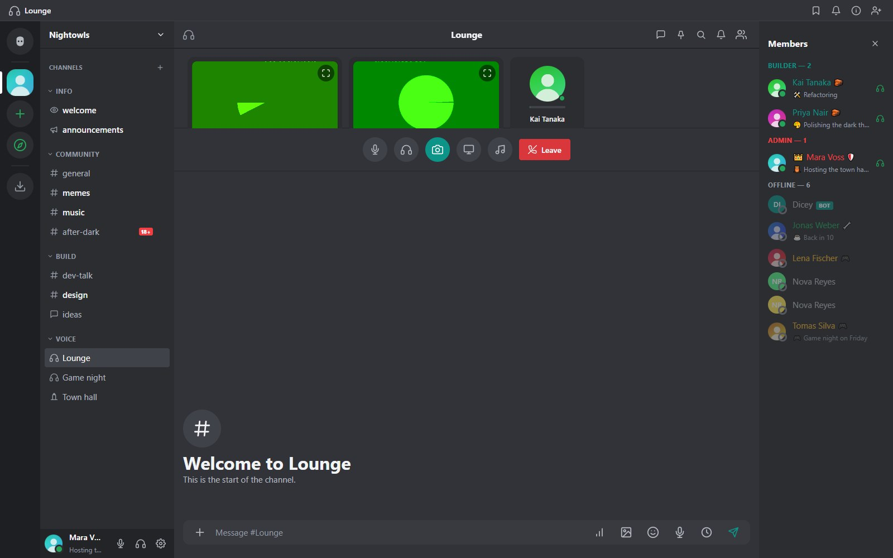

## How calls work

Voice and video are **peer-to-peer WebRTC**. Every participant connects directly to every other participant, and the server only relays the signaling over the same WebSocket used for chat. There is no media server to host.

::: note Plan for the size of the call
Because it is a full mesh, each person uploads their stream once per other participant. A call of roughly eight or more people with video asks a lot of everybody's upload bandwidth. Audio-only rooms scale much further.
:::

## Joining

Click a voice channel and press **Join voice**. Allow microphone access when the browser asks. Use the controls to mute, deafen, turn the camera on, share your screen, open the soundboard or leave. Calls need **HTTPS or localhost**, and people on different networks need a STUN or TURN server (see [Configuration](configuration.html)).

On each participant's tile you get a speaking ring and a live level strip. Each person's tile has its own volume slider.

The participant grid uses large tiles and scrolls when a room is full. In a voice channel the call panel sits above the text chat; **drag the divider between them** up or down to give the room or the chat more space. Your height is remembered in the browser. Stage channels use the same large, scrollable tiles. On a phone the call is a full screen of two-column tiles, with the text chat one tap away.

## Quality presets

The creator picks a preset when the channel is created. It is fixed afterwards: to change it, delete the channel and create a new one.

| Preset | Sample rate | Bitrate | Use |
|---|---|---|---|
| Mobile | 8 kHz | 12 kbps | Poor connections and phones on mobile data |
| Low | 16 kHz | 24 kbps | Speech on a weak line |
| Medium | 24 kHz | 48 kbps | The default |
| High | 48 kHz | 96 kbps | Clear speech |
| HD / Music | 48 kHz stereo | 192 kbps | Music and shared audio |

## Camera and screen sharing

Camera and screen share are separate tiles, so you can show both at once. Any video tile has a **fullscreen** button. The desktop app uses the system's screen and window picker; in a browser the browser's own picker appears. On a phone the camera has a **flip** button and screen sharing is not offered.

## Stage channels

A stage is a voice room split into **speakers** and an **audience**. The audience is muted until a speaker or moderator invites them. Audience members can **raise a hand**; a moderator can invite them to speak or move them back to the audience. Stages work well for town halls and announcements.

## Moderator tools

Members with **Moderate Members** can **mute for everyone** from another person's tile. The target's client stops sending audio and their own unmute button is disabled until a moderator lifts it; a badge shows on the tile. Without a media server this works by instructing the target's client, as in other chat apps.

## Private calls

Direct messages and group DMs support calls too. A DM call never appears on the "in a call" indicator of the member list or anywhere outside the DM's own members.

## Soundboard

A server can have a soundboard of short clips that members with permission can play into the call. Manage it under **Server Settings, Soundboard**.

## Noise suppression

**Settings, Voice, Advanced noise suppression (RNNoise)** runs your microphone through a small neural network compiled to WebAssembly, which removes keyboard, fan and background noise. It works on your own device, adds about ten milliseconds of delay and is off by default. The module (about 5 MB) is only downloaded the first time a call starts with it on. If it cannot start, the call simply continues without it.

## Troubleshooting calls

| Symptom | What to check |
|---|---|
| No microphone prompt | The page is not on HTTPS or localhost |
| Connects on the LAN but not across networks | Turn on the built-in STUN/TURN server (`setup-turn.bat`, or Admin Panel, Calls) and forward the ports on the router, see [STUN and TURN](configuration.html#stun-and-turn) |
| One person cannot be heard | Their browser blocked the microphone, or their input device is wrong in the device picker |
| Choppy audio in a big call | Lower the preset, or ask people to turn cameras off |
