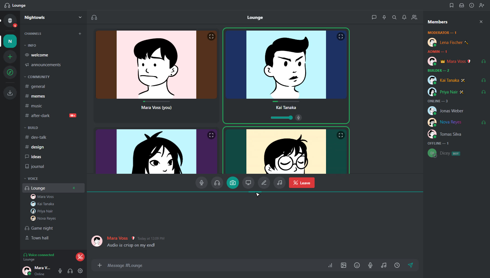
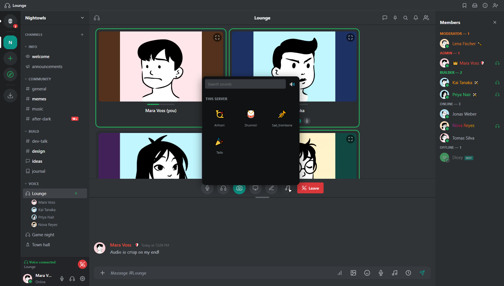
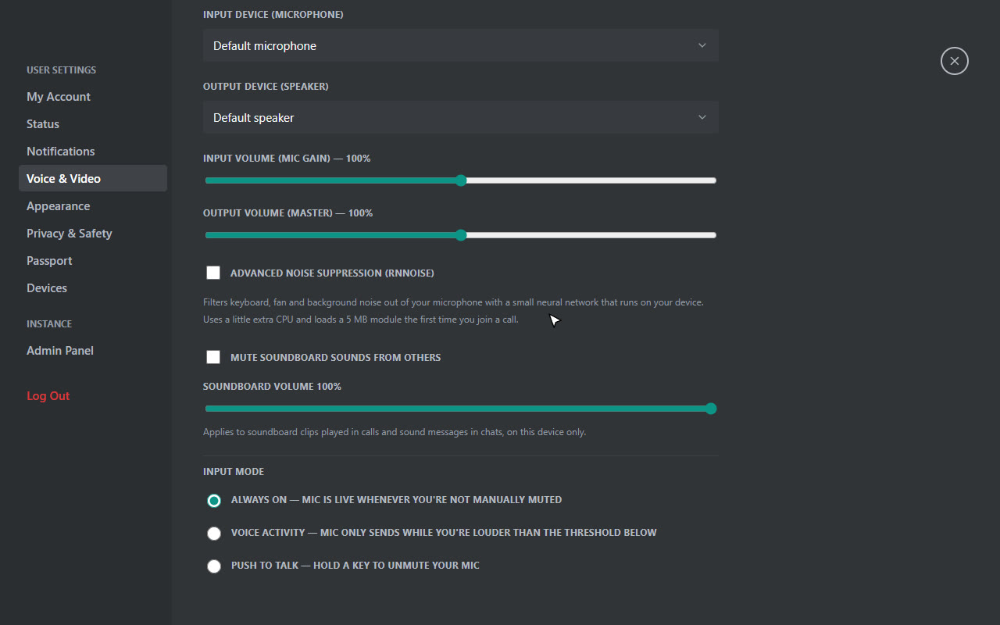

## How calls work

A server runs calls in one of two modes, chosen by the administrator (**Admin Panel, Calls, Voice engine**). It applies to every voice channel, stage and DM call, and is fixed for a room when the room is created, so a switch only affects rooms created afterwards.

- **Mesh** (the default): voice and video are **peer-to-peer WebRTC**. Every participant connects directly to every other participant, and the server only relays the signaling over the same WebSocket used for chat. There is no media server to host.
- **SFU** (selective forwarding): every participant sends their stream **once** to the server's built-in media router (mediasoup, running inside the server process), which forwards it to the others. Upload cost no longer grows with the size of the call, which fixes stutter in larger or video-heavy rooms and for people with weak uplinks.

::: note Plan for the size of the call
In mesh mode each person uploads their stream once per other participant. A call of roughly eight or more people with video asks a lot of everybody's upload bandwidth. Audio-only rooms scale much further, and SFU mode removes the limit.
:::

::: note Privacy in SFU mode
In mesh mode no server ever sees the media. In SFU mode the server terminates the encrypted call streams to forward them, so it technically can decrypt them. Choose it only for a server you trust. The admin panel shows a notice about this.
:::

You can use other channels, including text channels, while you are in a call; the call continues in a bar at the bottom. You can be in one voice room at a time: joining another one leaves the first. If you open the same call in a second tab or device, the call moves there and the first one ends with a notice.

## Joining

Click a voice channel and press **Join voice**. Allow microphone access when the browser asks. Use the controls to mute, deafen, turn the camera on, share your screen, open the soundboard or leave. Calls need **HTTPS or localhost**, and people on different networks need a STUN or TURN server (see [Configuration](configuration.html)).

On each participant's tile you get a speaking ring and a live level strip. Each person's tile has its own volume slider.

The participant grid uses large tiles and scrolls when a room is full. In a voice channel the call panel sits above the text chat; **drag the divider between them** up or down to give the room or the chat more space. Your height is remembered in the browser. Stage channels use the same large, scrollable tiles. On a phone the call is a full screen of two-column tiles, with the text chat one tap away.

## Quality presets

The creator picks a preset when the channel is created. It is fixed afterwards: to change it, delete the channel and create a new one.

| Preset | Sample rate | Bitrate | Use |
|---|---|---|---|
| Mobile | 8 kHz | 12 kbps | Poor connections and phones on mobile data |
| Low | 16 kHz | 24 kbps | Speech on a weak line |
| Medium | 24 kHz | 48 kbps | The default |
| High | 48 kHz | 96 kbps | Clear speech |
| HD / Music | 48 kHz stereo | 192 kbps | Music and shared audio |

## Camera and screen sharing

Camera and screen share are separate tiles, so you can show both at once. Any video tile has a **fullscreen** button. The desktop app uses the system's screen and window picker; in a browser the browser's own picker appears. On a phone the camera has a **flip** button and screen sharing is not offered.

## Stage channels

A stage is a voice room split into **speakers** and an **audience**. The audience is muted until a speaker or moderator invites them. Audience members can **raise a hand**; a moderator can invite them to speak or move them back to the audience. Stages work well for town halls and announcements.

## Moderator tools

Members with **Moderate Members** can **mute for everyone** from another person's tile. The target's client stops sending audio and their own unmute button is disabled until a moderator lifts it; a badge shows on the tile. In mesh mode this works by instructing the target's client; in SFU mode the server also pauses the person's stream, so a modified client cannot be heard either.

## Private calls

Direct messages and group DMs support calls too. A DM call never appears on the "in a call" indicator of the member list or anywhere outside the DM's own members.

## Soundboard

A server can have a soundboard of short clips that members with permission can play into the call. Manage it under **Server Settings, Soundboard**.

If clips from other people annoy you, open **Settings, Voice & Video** and tick **Mute soundboard sounds from others**, or lower **Soundboard volume**. It applies to clips played in calls and to sound messages in chats, on this device only. The soundboard popup also has a speaker button for a quick mute.

## Noise suppression

**Settings, Voice, Advanced noise suppression (RNNoise)** runs your microphone through a small neural network compiled to WebAssembly, which removes keyboard, fan and background noise. It works on your own device, adds about ten milliseconds of delay and is off by default. The module (about 5 MB) is only downloaded the first time a call starts with it on. If it cannot start, the call simply continues without it.

## Input mode, push-to-talk and echo reduction

Your microphone always has the browser's **echo cancellation**, **noise suppression** and **automatic gain control** switched on. Under **Settings, Voice & Video, Input Mode** you choose how the mic opens:

- **Always On**: the mic is live whenever you are not muted.
- **Voice Activity**: the mic only sends while you are louder than the **Sensitivity** slider.
- **Push to Talk**: hold the chosen key to talk. Two extra options appear:
  - **Release delay (ms)**, 0 to 2000: the mic stays open this long after you let go of the key, so the end of a sentence is not cut off. Pressing the key again during the delay keeps it open.
  - **Voice activation while using push-to-talk**: the mic also opens when you speak louder than the sensitivity threshold, without holding the key. Holding the key always works too.

**Echo reduction** (a separate checkbox) helps when you use speakers or an open mic: while your mic is picking up your voice, everyone else's playback is lowered by a number of decibels, by default 10. Type a value from 1 to 30 or use the up and down arrows. It uses the same sensitivity threshold as voice activation and only applies while you are actually transmitting.

All of these are saved on the device you set them on.

## How the connection path is chosen

Nothing to configure: each person's app tries every address it has at once (LAN, VPN such as Radmin, ZeroTier, SoftEther or Hamachi, and public) and uses the fastest one that works, so people on the same LAN or private VPN connect directly without any STUN or TURN server. STUN and TURN stay available as the automatic fallback for people on different networks.

Hover the colored quality dot on someone's tile to see the path: **direct (LAN/VPN)**, **via NAT (STUN)** or **relayed (TURN)**. The desktop app also lists this computer's network adapters there. A call that drops (VPN reconnect, Wi-Fi change) is retried automatically before it is closed.

Server owners can optionally list their LAN and VPN subnets, see [LAN and VPN networks](configuration.html#lan-and-vpn-networks).

## Troubleshooting calls

| Symptom | What to check |
|---|---|
| No microphone prompt | The page is not on HTTPS or localhost |
| Connects on the LAN but not across networks | Turn on the built-in STUN/TURN server (`setup-turn.bat`, or Admin Panel, Calls) and forward the ports on the router, see [STUN and TURN](configuration.html#stun-and-turn) |
| People on the same Radmin/ZeroTier/LAN network connect slowly or via a relay | Hover the quality dot to see the path. List the VPN subnet under **Admin Panel, Calls, LAN / VPN networks** so other adapters (Docker, WSL) are skipped, and check that the VPN allows UDP between members |
| One person cannot be heard | Their browser blocked the microphone, or their input device is wrong in the device picker |
| Choppy audio in a big call | Switch the server to SFU mode (Admin Panel, Calls, Voice engine), or lower the preset and ask people to turn cameras off |
| SFU mode: "a firewall may be blocking it" toast | Open the SFU port range on UDP and TCP in the server's firewall and router, and make sure the announced address is the public one, see [SFU voice engine](configuration.html#sfu-voice-engine) |
| SFU mode is selected but calls are mesh | The SFU could not start (worker missing for this operating system, or its ports are taken). Check the status line under Admin Panel, Calls, Voice engine; the server logs `[sfu]` lines |
